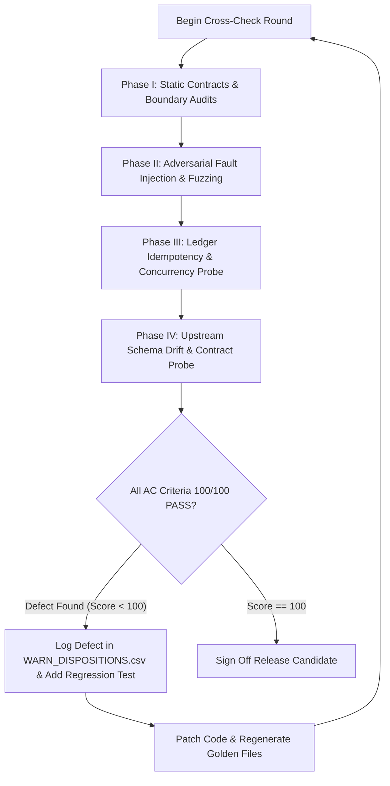

# 90_ACCEPTANCE.md

Acceptance criteria, test fixtures, MECE validation matrices, and recursive cross-check protocols for the MarkItDown-Flow v2 zero-base renewal.

---

## 1. Acceptance Checklist (`AC-xxx`)

### Scoring Rules
1. **Total Weight**: $\sum \text{Weight} = 100$.
2. **Binary Scoring**: Each criterion receives either `0` or full weight, unless an explicit partial scoring rubric is provided.
3. **Release Gate**: Release 2.0.0 requires **100/100** PASS. A single failure blocks release.
4. **Evidence Verifiability**: Every PASS verdict must link to an automated CI run, pytest log, jest log, or deterministic contract test output.

| ID | Decision / Stage | Measurable Pass Criterion | Evidence Type | Weight | Partial Rubric |
|---|---|---|---|:---:|---|
| **AC-001** | R1 / Stage 0, Stage 2 (Taxonomy) | Pure classification function determines `Route` $\in$ `{NATIVE, CONTAINER, LEGACY, PROTECTED, UNSUPPORTED}` and `Need` $\in$ `{NONE, PARTIAL, FULL, UNKNOWN}`. User labels match: $T = \text{NATIVE}+\text{NONE}$, $S = \text{NATIVE}+\text{FULL}$, $M = \text{NATIVE}+\text{PARTIAL}$. Audio/video maps to `Route=UNSUPPORTED` with reason `media_out_of_scope`. 100% accuracy across all corpus fixtures. | pytest | 4 | No partial credit. |
| **AC-002** | R1 / Stage 3 (Oversize Bound) | Files exceeding byte ceiling (default 100MB) or page ceiling (default 500 pages) are blocked at Plan stage as `OVERSIZE`, emitting a structured diagnostic plan without running conversion or OCR. No uncaught OOM on 500MB synthetic sparse files. | pytest | 4 | 2 pts if size capped but page count not capped. |
| **AC-003** | R2 / Stage 1 (Triage Contract) | Core `markitdown.ocr_triage.triage()` is called without side effects. Emits schema v1 valid JSON. Unrecognized schemas fail fast with a fatal diagnostic instead of running fallback logic. | pytest | 4 | No partial credit. |
| **AC-004** | R2 / Stage 4, Stage 10 (Pipeline Flow) | Linear execution through all 11 stages (0 Sniff $\to$ 1 Triage $\to$ 2 Classify $\to$ 3 Plan $\to$ 4 Convert $\to$ 5 Lookup $\to$ 6 Approve $\to$ 7 Render $\to$ 8 Transcribe $\to$ 9 Assemble $\to$ 10 Report). Each stage is idempotent, functional, and independently testable in isolation with mock inputs/outputs. | pytest | 4 | 2 pts if pipeline passes end-to-end but stages leak state. |
| **AC-005** | R3 / Stage 7 (OCR Unit Extraction) | Executable unit generated with schema `{kind: page\|media, source_id: str, raster_sha256: str, dpi: int}`. PDF pages split and rendered via `pypdfium2`. Office images extracted directly from zip stream matching sha256. Zero byte alteration of extracted raster assets. | pytest | 4 | 2 pts if PDF correct but Office image extraction alters bytes. |
| **AC-006** | R3 / Stage 7 (DPI & CJK Heuristics) | Default PDF render is 200 DPI. Dense CJK pages ($> 30\%$ CJK Unicode code points or glyph area density $> 40\%$) automatically escalate to 300 DPI as registered in the unit metadata. | pytest | 4 | 2 pts if 200 DPI fixed but CJK auto-escalation fails. |
| **AC-007** | R4 / Stage 5 (Content Ledger) | Content-addressed ledger cache stored strictly in `~/.mdflow/cache` (CLI) or `<plugin-dir>/cache` (Plugin). Key format matches `sha256(raster) + ":" + provider + ":" + model + ":" + prompt_version + ":" + str(dpi)`. Atomic file writes (`.tmp` renamed to `.json`). No sidecar `.mdflow.json` files emitted inside the vault workspace. | pytest | 5 | 2 pts if cache works but writes are non-atomic. 0 pts if vault is polluted. |
| **AC-008** | R4 / Stage 5 (Ledger Idempotency) | Running `mdflow` twice on identical inputs with identical configuration results in **exactly 0 provider/network calls** on the second run. All text assembled from local ledger cache. | pytest | 5 | No partial credit. |
| **AC-009** | R5 / Stage 9 (PDF Placement) | PDF output preserves page structure via explicit anchors `<!-- mdflow:page N -->`. OCR transcribed text is appended directly within the respective page boundaries in numerical order. Markdown structure remains well-formed. | pytest | 4 | 2 pts if pages disordered or markers missing. |
| **AC-010** | R5 / Stage 9 (Office Media Placement) | In DOCX/PPTX/XLSX, OCR transcribed text replaces or immediately annotates the extracted image link `` in-situ, keyed by sha256 prefix match. Zero orphan transcriptions at document footer. | pytest | 4 | 2 pts if transcript placed at footer instead of in-situ. |
| **AC-011** | R6 / Stage 6 (Egress & Consent Gate) | Any provider declaring `egress=True` halts execution at Stage 6 with exit code / status `APPROVAL_REQUIRED` unless `--yes` (CLI) or modal confirmation (Plugin) is supplied. Gate triggered unconditionally if units $> 20$ or input path matches user-configured sensitive globs. Plan summary hash verified prior to execution. | pytest / jest | 5 | 2 pts if `--yes` works but glob checks fail. |
| **AC-012** | R8 (Secrets Hygiene) | Zero plain-text API keys or credentials in persistent configuration files, CLI arguments, log streams, IPC messages, or error stack traces. Child process environments scrubbed of all ambient cloud/API credentials except explicitly allow-listed tokens. | pytest / CI | 5 | 0 pts if any token leaks in debug log. |
| **AC-013** | R7 (Provider Implementations) | Built-in provider matrix strictly limited to: `none` (default, emits pending markers), `openai-compatible` (stdlib HTTP client, supporting OpenAI, Anthropic-compat, Ollama, Gemini-compat via `base_url`), and `command` (generic CLI template with env secret interpolation). Tested via hermetic mock servers. | pytest | 4 | 2 pts if `none` and `openai` pass but `command` template fails. |
| **AC-014** | R7 (Azure Deprecation Path) | Legacy configurations specifying Azure DocIntel or Azure Computer Vision emit a graceful migration warning pointing to external command recipes or `openai-compatible` vision endpoints. Zero runtime crashes on obsolete v1 settings. | pytest / jest | 4 | No partial credit. |
| **AC-015** | R10 (Runtime Bootstrap) | Obsidian plugin SetupModal creates an isolated Python virtual environment inside `<plugin-dir>/.venv` and installs pinned wheels for `mdflow` and `markitdown-gc==0.3.5`. System Python is used only for `venv` bootstrap. Platform paths resolved safely across Win, macOS, Linux. | jest / manual | 4 | 2 pts if Linux/macOS work but Windows path spaces fail. |
| **AC-016** | R10 (IPC & Cancellation) | Desktop plugin communicates with engine via bidirectional JSON-lines stream over stdio. Protocol adheres to `{type: "progress"|"unit_complete"|"error"|"result", ...}`. Aborting execution in Obsidian sends `SIGINT`/`SIGTERM`, causing engine to cleanly flush open ledger writes and terminate within 1500ms without orphan lockfiles. | jest / pytest | 4 | 2 pts if progress streams but cancellation leaks process. |
| **AC-017** | R11 (Legacy Format Rejection) | Files with extensions `.doc`, `.ppt`, `.rtf`, `.xls` are tagged `Route=LEGACY`. Engine rejects processing with a clear status report, providing LibreOffice batch-conversion hints. Zero automated un-sandboxed shell spawns of `soffice`. | pytest | 4 | No partial credit. |
| **AC-018** | R9 (Internationalization) | UI and error strings fully externalized into structured localization dictionaries for English (`en`, fallback) and Korean (`ko`). All dynamic parameter insertions sanitized. Output markdown headings and ledger comments remain language-neutral. | jest / pytest | 4 | 2 pts if Korean translations missing keys. |
| **AC-019** | R12 (Contract Test Suite) | Automated contract suite executes against upstream `markitdown-gc` releases. Suite validates triage output structure, schema invariants, and media extraction behavior. Fails loudly on `schema_version != 1`. | pytest / CI | 5 | No partial credit. |
| **AC-020** | R12 (Multi-Platform CI Matrix) | Full test suite passes across GitHub Actions matrix: Windows Server 2022, Ubuntu 22.04, macOS 14 on Python 3.10 and 3.14. Python 3.15 run configured as experimental/non-blocking. | CI | 5 | 3 pts if 2/3 OSes pass. |
| **AC-021** | R13 (Corpus Classification Accuracy) | 100% correct classification of all labelled test corpus files (FX-001 through FX-035) across `Route`, `Need`, `Label`, and unit candidate identification. | pytest | 5 | Deduct 1 pt per misclassified fixture down to 0. |
| **AC-022** | R13 (Zero Loss / Duplication) | Under all conditions (including partial failures, simulated timeouts, and retries), total output OCR units match planned units without duplication, truncation, or orphan dropped blocks. | pytest | 5 | No partial credit. |
| **AC-023** | R14 (Obsidian Release Standard) | Package bundle satisfies all Obsidian community review constraints: description $\le 250$ chars, command IDs do not repeat plugin ID, zero sample/boilerplate code, static asset manifest accurate, clean npm audit, semver 2.0.0 tag alignment. | jest / CI | 4 | No partial credit. |

---

## 2. Labelled Fixture Corpus Plan (`FX-xxx`)

All fixtures are maintained in `tests/fixtures/` and are generated programmatically via `python -m tests.tools.generate_fixtures` unless marked as binary-frozen.

| Fixture ID | Name / Description | Generation Method | Route | Need | Label | Expected Candidate IDs | Expected Units |
|---|---|---|:---:|:---:|:---:|---|:---:|
| **FX-001** | Born-digital 1-page PDF | ReportLab: pure text paragraphs, standard font | `NATIVE` | `NONE` | `T` | `[]` | 0 |
| **FX-002** | Born-digital multi-page PDF (5 pages) | ReportLab: 5 pages of pure flowing text | `NATIVE` | `NONE` | `T` | `[]` | 0 |
| **FX-003** | Pure scanned 1-page PDF | ReportLab + Pillow: 200 DPI bitmap rendered full-page | `NATIVE` | `FULL` | `S` | `["p1"]` | 1 |
| **FX-004** | Pure scanned multi-page PDF (3 pages) | ReportLab + Pillow: 3 pages of scanned document images | `NATIVE` | `FULL` | `S` | `["p1", "p2", "p3"]` | 3 |
| **FX-005** | Mixed PDF (Text + Scanned Receipt page) | ReportLab: Page 1 text, Page 2 embedded full bitmap scan | `NATIVE` | `PARTIAL` | `M` | `["p2"]` | 1 |
| **FX-006** | Mixed PDF (Vector text + inline photo figure) | ReportLab: Page 1 text with small inline figure | `NATIVE` | `PARTIAL` | `M` | `["p1"]` | 1 |
| **FX-007** | High-density CJK PDF (Korean/Hanja table) | ReportLab: Dense Korean administrative register ($>50\%$ CJK) | `NATIVE` | `FULL` | `S` | `["p1"]` | 1 (300 DPI) |
| **FX-008** | Rotated scan PDF (90° clockwise scan) | ReportLab + Pillow: rotated text raster with /Rotate 90 tag | `NATIVE` | `FULL` | `S` | `["p1"]` | 1 |
| **FX-009** | DOCX without images | `python-docx`: 3 paragraphs of standard text | `NATIVE` | `NONE` | `T` | `[]` | 0 |
| **FX-010** | DOCX with embedded PNG diagram | `python-docx`: text + `word/media/image1.png` | `NATIVE` | `PARTIAL` | `M` | `["word/media/image1.png"]` | 1 |
| **FX-011** | DOCX with multiple mixed images (PNG+JPEG) | `python-docx`: text + 2 diagrams + 1 logo | `NATIVE` | `PARTIAL` | `M` | `["word/media/image1.png", "word/media/image2.jpeg", "word/media/image3.png"]` | 3 |
| **FX-012** | PPTX presentation without images | `python-pptx`: 3 slides, title and bullet points | `NATIVE` | `NONE` | `T` | `[]` | 0 |
| **FX-013** | PPTX slide deck with scanned slides | `python-pptx`: 2 slides containing full-bleed slide images | `NATIVE` | `PARTIAL` | `M` | `["ppt/media/image1.png", "ppt/media/image2.png"]` | 2 |
| **FX-014** | XLSX workbook without images | `openpyxl`: 2 sheets of tabular financial numbers | `NATIVE` | `NONE` | `T` | `[]` | 0 |
| **FX-015** | XLSX workbook with embedded chart snapshot | `openpyxl`: 1 sheet text + embedded floating PNG image | `NATIVE` | `PARTIAL` | `M` | `["xl/media/image1.png"]` | 1 |
| **FX-016** | Standalone PNG screenshot | Pillow: 800x600 synthetic terminal snapshot | `NATIVE` | `FULL` | `S` | `["image"]` | 1 |
| **FX-017** | Standalone JPEG scanned letterhead | Pillow: 1200x1600 synthetic photo with JPEG noise | `NATIVE` | `FULL` | `S` | `["image"]` | 1 |
| **FX-018** | Multi-frame TIFF (3 pages document) | Pillow: multi-frame TIFF containing 3 raster pages | `NATIVE` | `FULL` | `S` | `["p1", "p2", "p3"]` | 3 |
| **FX-019** | HWP 5.0 document (Binary) | Programmatic minimal OLE container with Text streams | `NATIVE` | `NONE` | `T` | `[]` | 0 |
| **FX-020** | HWPX document with embedded scan | Minimal ZIP-based HWPX with Section XML + `BinData/image1.png` | `NATIVE` | `PARTIAL` | `M` | `["BinData/image1.png"]` | 1 |
| **FX-021** | Standard flat ZIP container | `zipfile`: contains `FX-001.pdf` and `FX-009.docx` | `CONTAINER` | `NONE` | `C` | Evaluated per member | 0 |
| **FX-022** | Nested ZIP container (2 levels deep) | `zipfile`: `outer.zip` containing `inner.zip` containing `FX-003.pdf` | `CONTAINER` | `FULL` | `C` | Evaluated per member | 1 (in leaf) |
| **FX-023** | ZIP with pathological paths (Directory traversal) | `zipfile`: member path `../../etc/passwd` and `CON.txt` | `CONTAINER` | `UNKNOWN` | `C` | Blocked / Sanitized | 0 |
| **FX-024** | Decompression bomb ZIP (42KB -> 10GB sparse) | `zipfile`: highly compressed zero-byte streams | `CONTAINER` | `UNKNOWN` | `C` | Blocked by bound | 0 |
| **FX-025** | Password-protected PDF | PyPDF2/pikepdf: encrypted with user password `secret` | `PROTECTED` | `UNKNOWN` | `U` | `[]` (Reason: `encrypted`) | 0 |
| **FX-026** | Password-protected ZIP archive | `zipfile`: encrypted with ZipCrypto/AES password | `PROTECTED` | `UNKNOWN` | `U` | `[]` (Reason: `encrypted`) | 0 |
| **FX-027** | Zero-byte empty file (`empty.pdf`) | Standard 0-byte file | `UNSUPPORTED` | `UNKNOWN` | `U` | `[]` (Reason: `empty_file`) | 0 |
| **FX-028** | Truncated corrupt PDF | Truncated after 128 bytes of PDF header | `UNSUPPORTED` | `UNKNOWN` | `U` | `[]` (Reason: `corrupt_header`) | 0 |
| **FX-029** | Corrupt DOCX (Invalid ZIP directory) | Random byte sequence with `.docx` extension | `UNSUPPORTED` | `UNKNOWN` | `U` | `[]` (Reason: `invalid_zip`) | 0 |
| **FX-030** | Oversize PDF (Exceeds max byte bound) | Sparse binary file padded to 150MB | `NATIVE` | `NONE` | `T` | Blocked at Plan stage | 0 |
| **FX-031** | Legacy Microsoft Word binary (`test.doc`) | Real legacy Word 97-2003 binary compound file | `LEGACY` | `UNKNOWN` | `L` | `[]` (Reason: `legacy_format`) | 0 |
| **FX-032** | Legacy PowerPoint binary (`test.ppt`) | Real legacy PowerPoint 97-2003 binary file | `LEGACY` | `UNKNOWN` | `L` | `[]` (Reason: `legacy_format`) | 0 |
| **FX-033** | Plain Text file (`sample.txt`) | UTF-8 encoded text paragraphs | `NATIVE` | `NONE` | `T` | `[]` | 0 |
| **FX-034** | Markdown document (`sample.md`) | CommonMark document with syntax tables | `NATIVE` | `NONE` | `T` | `[]` | 0 |
| **FX-035** | Audio file (`recording.mp3`) | Synthetic 1-second silence MP3 file | `UNSUPPORTED` | `UNKNOWN` | `A` | `[]` (Reason: `media_out_of_scope`) | 0 |

---

## 3. MECE Audit Matrices

### Vertical Matrix: Pipeline Stage vs. Failure Mode

Each matrix cell must explicitly identify the governing Acceptance Criterion (`AC-xxx`) enforcing safety or indicate `N/A` with architectural justification.

| Pipeline Stage | FM-1: Corrupt / Malformed Input | FM-2: Encryption / Protection | FM-3: Resource Bound (Oversize/ZipBomb) | FM-4: Pathological Naming / Traversal | FM-5: Schema / Dep Drift | FM-6: Network / Provider Timeout | FM-7: User Gate Rejection | FM-8: Cache Corruption / Partial State |
|---|:---:|:---:|:---:|:---:|:---:|:---:|:---:|:---:|
| **Stage 0: Sniff** | **AC-001** (Flags invalid magic) | **AC-001** (Sniffs crypto header) | **AC-002** (Checks raw file size) | **AC-001** (Sanitizes input path) | N/A (Pure stdlib) | N/A (Local stage) | N/A (Autonomous) | N/A (No cache access) |
| **Stage 1: Triage** | **AC-003** (Core handles & reports) | **AC-001** (Emits protected status) | **AC-002** (Bounded triage execution) | N/A (Uses fd/safe name) | **AC-003** (Strict schema v1 check) | N/A (Local stage) | N/A (Autonomous) | N/A (No cache access) |
| **Stage 2: Classify** | **AC-001** (Maps to `UNSUPPORTED`) | **AC-001** (Maps to `PROTECTED`) | **AC-001** (Deterministic mapping) | N/A (Path-agnostic) | **AC-003** (Fails on invalid schema) | N/A (Pure fn) | N/A (Pure fn) | N/A (No cache access) |
| **Stage 3: Plan** | **AC-004** (Emits error plan) | **AC-004** (Emits locked plan) | **AC-002** (Rejects `OVERSIZE`) | **AC-004** (Canonical ID generation) | **AC-019** (Type safe plan generation) | N/A (Local stage) | N/A (Autonomous) | N/A (Read-only stage) |
| **Stage 4: Convert** | **AC-004** (Catches core crash) | N/A (Blocked by Stage 3) | **AC-002** (Enforces core memory limit) | **AC-004** (Safe media extract paths) | **AC-019** (Validates output structure) | N/A (Local stage) | N/A (Autonomous) | N/A (Read-only stage) |
| **Stage 5: Lookup** | N/A (Keys derived from bytes) | N/A (Blocked by Stage 3) | N/A (Cache keys are bounded sha256) | **AC-007** (Keys use strict hex regex) | N/A (Ledger schema invariant) | N/A (Local disk stage) | N/A (Autonomous) | **AC-007** (Corrupt cache discarded) |
| **Stage 6: Approve** | N/A (Plan pre-validated) | N/A (Plan pre-validated) | **AC-011** (Prompts unit count warning) | **AC-011** (Matches sensitive globs) | N/A (Local UI gate) | N/A (Local UI gate) | **AC-011** (Clean exit on rejection) | N/A (Pre-execution) |
| **Stage 7: Render** | **AC-005** (Fails page render safely) | N/A (Blocked by Stage 3) | **AC-006** (DPI capping limits RAM) | N/A (In-memory buffer) | **AC-005** (Validates pypdfium2 API) | N/A (Local rasterization) | N/A (Approved prior) | N/A (In-memory buffer) |
| **Stage 8: Transcribe**| N/A (Validated rasters) | N/A (In-memory rasters) | **AC-011** (Batch limits enforced) | N/A (Identifiers are sha256) | **AC-013** (Response parser contracts) | **AC-022** (Retry with exp backoff) | **AC-016** (Honors abort signal) | **AC-007** (Atomic cache write) |
| **Stage 9: Assemble** | **AC-009** (Validates text markers) | N/A (No text emitted) | **AC-022** (Stream assembly limits) | **AC-010** (Anchor string sanitization)| N/A (Pure text logic) | N/A (Local stage) | N/A (Post-execution) | **AC-022** (Zero-duplication invariant) |
| **Stage 10: Report** | **AC-004** (Emits structured error) | **AC-004** (Emits protected error) | **AC-002** (Reports size stats) | **AC-016** (Sanitizes terminal/IPC) | **AC-016** (Schema matches IPC spec) | **AC-004** (Reports failed unit list) | **AC-011** (Emits aborted status) | **AC-008** (Reports cache hit ratios) |

---

### Horizontal Matrix: File Route / Class vs. Pipeline Stage

Every combination of file category and pipeline processing stage must be bounded by an acceptance test or accounted for by design.

| File Route & Label | Stage 0: Sniff | Stage 1: Triage | Stage 2: Classify | Stage 3: Plan | Stage 4: Convert | Stage 5: Lookup | Stage 6: Approve | Stage 7: Render | Stage 8: Transcribe | Stage 9: Assemble | Stage 10: Report |
|---|:---:|:---:|:---:|:---:|:---:|:---:|:---:|:---:|:---:|:---:|:---:|
| **Class T: Born-Digital (`NATIVE + NONE`)** | **AC-001** | **AC-003** | **AC-001** | **AC-004** | **AC-004** | N/A (0 units) | N/A (0 units) | N/A (0 units) | N/A (0 units) | **AC-009** | **AC-004** |
| **Class S: Pure Scan (`NATIVE + FULL`)** | **AC-001** | **AC-003** | **AC-001** | **AC-004** | **AC-004** (Base empty) | **AC-007** | **AC-011** | **AC-005** | **AC-013** | **AC-009** | **AC-004** |
| **Class M: Mixed Text/OCR (`NATIVE + PARTIAL`)**| **AC-001** | **AC-003** | **AC-001** | **AC-004** | **AC-004** | **AC-007** | **AC-011** | **AC-005** | **AC-013** | **AC-010** | **AC-004** |
| **Class C: Container (`CONTAINER`)** | **AC-001** | N/A (Recurse members) | **AC-001** | **AC-002** (Depth/size bounds) | **AC-004** (Unpacks safely) | Evaluated per member | Evaluated aggregate | Evaluated per member | Evaluated per member | **AC-004** (Compound md) | **AC-004** |
| **Class L: Legacy (`LEGACY`)** | **AC-001** | N/A (Core unsupported)| **AC-001** | **AC-017** (Reject plan) | N/A (Blocked) | N/A (Blocked) | N/A (Blocked) | N/A (Blocked) | N/A (Blocked) | N/A (Blocked) | **AC-017** (So-office hint) |
| **Class P: Protected (`PROTECTED`)** | **AC-001** | **AC-003** (Detects crypto) | **AC-001** | **AC-004** (Halt plan) | N/A (Blocked) | N/A (Blocked) | N/A (Blocked) | N/A (Blocked) | N/A (Blocked) | N/A (Blocked) | **AC-004** (Auth error) |
| **Class U: Unsupported / Corrupt (`UNSUPPORTED`)**| **AC-001** | **AC-003** (Fails safely) | **AC-001** | **AC-004** (Halt plan) | N/A (Blocked) | N/A (Blocked) | N/A (Blocked) | N/A (Blocked) | N/A (Blocked) | N/A (Blocked) | **AC-004** (Diagnostic) |
| **Class A: Media / Audio (`UNSUPPORTED: media`)** | **AC-001** | N/A (Sniff route) | **AC-001** | **AC-001** (Out of scope) | N/A (Blocked) | N/A (Blocked) | N/A (Blocked) | N/A (Blocked) | N/A (Blocked) | N/A (Blocked) | **AC-001** (Scope notice) |

---

## 4. Defect-Hunt Protocol for Recursive Cross-Check Rounds

To achieve defect-free release stability, the implementation team must execute three recursive, adversarial cross-check rounds prior to closing the v2 renewal milestone.

### Phase I: Static Contracts & Boundary Audits
1. **Line Ending & Encoding Integrity**:
   - Every text source, test fixture, and template must retain strict line ending invariants (Windows CRLF preserved where configured, Unix LF for Python source).
   - Verify with: `git ls-files --stage` and internal EOL validation script. Zero unintended line ending churn.
2. **Pathological Namespace Verification**:
   - Execute pipeline against synthetic inputs containing non-ASCII Unicode (Korean, Arabic, Emoji), space-heavy paths, POSIX root collisions (`/tmp`), and Windows reserved device names (`CON`, `PRN`, `AUX`, `NUL`, `COM1-9`, `LPT1-9`).
   - Pass condition: Path parsing must resolve through `pathlib.Path` with zero unhandled `OSError` or path traversal vulnerability.

### Phase II: Dynamic Mutation & Adversarial Fault Injection
1. **Network Chaos Simulation**:
   - Intercept provider HTTP calls with a programmable fault proxy.
   - Inject transient network faults: 
     - HTTP 429 (Rate Limit Exceeded) with `Retry-After` headers.
     - HTTP 500/503 server errors.
     - Abrupt TCP connection drops mid-stream after emitting partial byte chunks.
   - Pass condition: Pipeline must retry with exponential jittered backoff on transient codes, fail gracefully on terminal errors, record failure reasons in Stage 10 report, and leave zero corrupted entries in the cache ledger.
2. **Process Murder & IPC Interruption**:
   - Spawn `mdflow` CLI via plugin mock; issue `SIGINT` (Ctrl+C) and `SIGTERM` at random intervals during Stages 4, 7, and 8.
   - Pass condition: Process terminates within $\le 1500\text{ ms}$. Zero left-over `.tmp` files in `~/.mdflow/cache`. Re-running the command immediately succeeds without manual lock cleanup.

### Phase III: Idempotency & Provenance Cross-Verification
1. **Cache Permutation Invariance**:
   - Run corpus `FX-001` through `FX-035` to completion.
   - Backup the resulting `~/.mdflow/cache` state.
   - Touch source file modification times (`mtime`) without altering contents.
   - Re-run pipeline with identical parameters.
   - Pass condition: Cache hit rate must be exactly $100\%$ for candidate rasters. Network egress count must be exactly $0$. Output files must match byte-for-byte with initial run (`diff -u` returns zero differences).
2. **Vault Non-Pollution Verification**:
   - Run complete suite inside an Obsidian test vault.
   - Scan vault tree for unexpected sidecar files (`*.mdflow.json`, `*.tmp`, `*.cache`).
   - Pass condition: Strictly zero untracked sidecars created in the vault. All state must reside in `<plugin-dir>/cache` or specified destination `.md`.

### Phase IV: Triage Schema Drift & Compatibility Probe
1. **Upstream Monkey Patch Audit**:
   - Mock `markitdown.ocr_triage.triage()` output with mutations:
     - Missing optional fields (`summary`, `issues`).
     - Increment `schema_version` from `1` to `2`.
     - Introduce unknown enum strings in `coverage.state` or `candidates.kind`.
   - Pass condition: On `schema_version != 1`, engine must throw `IncompatibleCoreSchemaError` with clear upgrade guidance. On minor variations, engine must use defensive dictionary access without `KeyError`.

### Defect Closure & Regression Policy
- Any failure discovered during recursive cross-check triggers the addition of a permanent minimal reproducing test fixture (`FX-xxx`) and a designated regression test in `tests/test_regressions.py`.
- No defect is considered closed until the test suite passes 100/100 on all platforms in the GitHub Actions matrix. Clean state is attested before tag creation.

> Status: DRAFT-1 by ag.effort (flash); pending cross-review (round 3).
